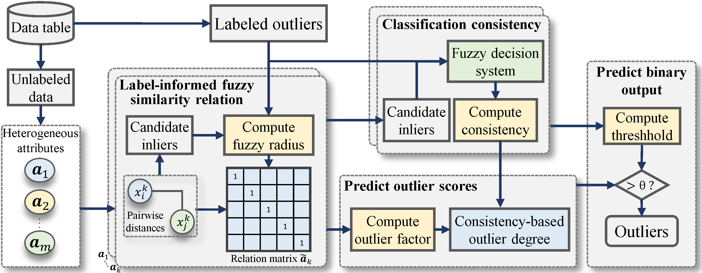

# COD
Baiyang Chen, Zhong Yuan, Dezhong Peng, Xiaoliang Chen, and Hongmei Chen, "[Consistency-guided semi-supervised outlier detection in heterogeneous data using fuzzy rough sets](Paper/2024-COD.pdf)," Applied Soft Computing, vol. 165, article 112070, 2024. DOI: [10.1016/j.asoc.2024.112070](https://doi.org/10.1016/j.asoc.2024.112070).

The maintenance version **1.1**, COD has been reorganized into a Python package featuring a concise, unified API, making it easy to use.

## Abstract
Outlier detection aims to find objects that behave differently from the majority of the data. Semi-supervised detection methods can utilize the supervision of partial labels, thus reducing false positive rates. However, most of the current semi-supervised methods focus on numerical data and neglect the heterogeneity of data information. In this paper, we propose a consistency-guided outlier detection algorithm (COD) for heterogeneous data with the fuzzy rough set theory in a semi-supervised manner. First, a few labeled outliers are leveraged to construct label-informed fuzzy similarity relations. Next, the consistency of the fuzzy decision system is introduced to evaluate attributes’ contributions to knowledge classification. Subsequently, we define the outlier factor based on the fuzzy similarity class and predict outliers by integrating the classification consistency and the outlier factor. The proposed algorithm is extensively evaluated on 20 freshly proposed datasets. Experimental results demonstrate that COD is better than or comparable with the leading outlier detectors.

## Framework


## Datasets
The paper evaluates 20 datasets; 15 are provided here: 2 categorical, 2 mixed, and 11 numerical datasets. Sample counts range from 351 to 11,183, with anomaly ratios from 2.0% to 35.9%.

Each NPZ contains `X` (features), `y` (1=anomaly, 0=normal, used to simulate known labels and compute evaluation metrics), and `nominals` (a Boolean column mask). Numerical columns are already min-max normalized; categorical codes need not lie in [0, 1]. The experiment script removes columns with standard deviation at most `1e-6`, using the supplied mask for all remaining columns.


| No 	|   Datasets  	| #Samples 	| #Attributes 	| #Outlier 	| %Outlier 	|   Category  	|   DataType  	|
|:--:	|:-----------:	|:--------:	|:-----------:	|:--------:	|:--------:	|:-----------:	|:-----------:	|
|  1 	|  annthyroid 	|   7200   	|      6      	|    534   	|   7.4%   	|  Healthcare 	|  Numerical  	|
|  2 	|  Arrhythmia 	|    452   	|     279     	|    66    	|   14.6%  	|   Medical   	|    Mixed    	|
|  3 	|   breastw   	|    683   	|      9      	|    239   	|   35.0%  	|  Healthcare 	|  Numerical  	|
|  4 	|    cardio   	|   1831   	|      21     	|    176   	|   9.6%   	|  Healthcare 	|  Numerical  	|
|  5 	|  Ionosphere 	|    351   	|      32     	|    126   	|   35.9%  	| Oryctognosy 	|  Numerical  	|
|  6 	| mammography 	|   11183  	|      6      	|    260   	|   2.3%   	|  Healthcare 	|  Numerical  	|
|  7 	|  Mushroom1  	|   4429   	|      22     	|    221   	|   5.0%   	|    Botany   	| Categorical 	|
|  8 	|  Mushroom2  	|   4781   	|      22     	|    573   	|   12.0%  	|    Botany   	| Categorical 	|
|  9 	|     musk    	|   3062   	|     166     	|    97    	|   3.2%   	|  Chemistry  	|  Numerical  	|
| 10 	|  optdigits  	|   5216   	|      64     	|    150   	|   2.9%   	|    Image    	|  Numerical  	|
| 11 	|  PageBlocks 	|   5393   	|      10     	|    510   	|   9.5%   	|   Document  	|  Numerical  	|
| 12 	|     Sick    	|   3613   	|      29     	|    72    	|   2.0%   	|   Medical   	|    Mixed    	|
| 13 	|   Waveform  	|   3443   	|      21     	|    100   	|   2.9%   	|   Physical  	|  Numerical  	|
| 14 	|     Wilt    	|   4819   	|      5      	|    257   	|   5.3%   	|    Botany   	|  Numerical  	|
| 15 	|    yeast    	|   1484   	|      8      	|    507   	|   34.2%  	|   Biology   	|  Numerical  	|


## Installation

From the repository root, install with Python 3.8+:

```bash
python -m pip install ".[experiments]"
```

The `cod-outlier` package uses NumPy float64 on CPU. The `experiments` extra adds scikit-learn for the example and evaluation scripts. Datasets and paper materials remain in the repository and are not installed with the package.

## Usage

```python
import numpy as np
from cod import COD

with np.load("data/breastw.npz") as data:
    X, y, nominals = data["X"], data["y"], data["nominals"]

# Simulate five known anomaly labels for this example.
known = np.random.RandomState(2023).choice(np.flatnonzero(y), 5, replace=False)
train_y = np.zeros(len(X), dtype=int)
train_y[known] = 1
model = COD().fit(X, train_y, nominals)
scores = model.predict_score()  # Scores for all fitted rows, in input order.
```

`X` has shape `(n, m)`; `(n, m, 1)` is also accepted. Encode string categories and handle missing values before fitting. `fit` applies min-max normalization to numerical columns over the fitted universe and leaves categorical codes unchanged. Constant numerical columns map to zero; input arrays are not modified.

`nominals` is optional. With `COD().fit(X, train_y)`, a column is categorical if it has **2–5 distinct, exactly integer-valued entries**; otherwise it is numerical. Inference uses the fitted universe before normalization: `1.0` is integer-valued, while `1.000001` is not. Inspect `model.nominals_` for the Boolean column mask used by a fitted model.

An explicit Boolean/0-1 mask takes priority, for example `COD().fit(X, train_y, nominals=[False] * X.shape[1])` treats every column as numerical. Supply known attribute types when available: the heuristic can mistake small-range counts for categories and treats attributes with more than five categories as numerical. Invalid explicit masks raise an error.

`train_y=1` identifies a known outlier; `0` means unlabeled. Hidden anomaly labels must remain zero. `fit` returns the model, and larger scores indicate stronger outlier evidence.

COD is transductive: `predict_score()` returns a copy of the scores for the fitted universe and accepts no query data. Fit a new model to analyze a different universe. See [`example.py`](example.py) for data loading, simulated known labels, and evaluation excluding known outliers; replace its marked data block to use your own dataset.

- `n_neg=100`: maximum candidate inliers per attribute, selected from unlabeled rows by ascending mean distance to the full universe; ties follow input row order.
- `batch_size=256`: relation rows per block. Every block uses the full universe as its reference.
- `normalize=True`: apply min-max preprocessing. Set `normalize=False` to use numerical inputs already normalized to [0, 1].

Numerical radii maximize Eq. (6) over `0.001, 0.002, ..., 0.999`, choosing the smallest radius on ties. Singleton outlier factors are weighted by classification consistency (Eqs. 12-14). Learned `radii_` (`-1` for categorical columns) and `consistencies_` are available on the fitted model.

## Experiments

Run the 15 bundled datasets with ten repetitions each:

```bash
python reproducing_paper_results.py
```

Select datasets, seeds, and an output directory:

```bash
python reproducing_paper_results.py --datasets breastw mushroom1 arrhythmia --seeds 2023 --output-dir outputs/run1
```

Defaults are five known outliers, 100 candidate inliers per attribute, and seeds `2023` through `2032`. Each repetition samples known outliers without replacement using a local `RandomState(seed)`. The seed range follows the repository convention; the paper does not specify exact seeds. Only these known labels are supplied to COD. All rows participate in normalization and relation calculations; known outliers are excluded from evaluation. Metrics are AUROC and average precision (AP).

Use `--n-labeled-outliers`, `--n-neg`, and `--batch-size` to change the corresponding counts. Normalization is enabled by default; pass `--no-normalize` to keep supplied pre-normalized values unchanged. `--data-dir` selects a directory of NPZ datasets with `X`, `y`, and an optional `nominals` mask. The bundled datasets use their supplied masks; inference is used only when that field is absent.

Each run creates a new directory under `outputs/`; existing directories are refused. `results_COD.csv` contains full-precision per-seed metrics, known-outlier indices, evaluated sample and retained feature counts, normalization and batch size. `n_neg_requested` records the requested candidate count; `n_neg` records the actual count, capped by the number of unlabeled rows. The console displays both counts and the actual configuration. `summary_COD.csv` contains dataset means, population standard deviations (`ddof=0`), and the unweighted mean across datasets.

The reference results are the COD columns in Tables 3 and 4 of the paper (five labeled outliers). Compare dataset-level results on the 15 bundled datasets; the paper's average covers all 20 datasets. Current results do not exactly reproduce the published tables. The script reports average precision (AP), while the paper names its precision-recall metric AUC-PR without specifying the integration convention.

## Citation
If you find the code or datasets useful in your research, please consider citing:
```
@article{Chen2024COD,
  title = {Consistency-guided semi-supervised outlier detection in heterogeneous data using fuzzy rough sets},
  journal = {Applied Soft Computing},
  volume = {165},
  pages = {112070},
  year = {2024},
  issn = {1568-4946},
  author = {Baiyang Chen and Zhong Yuan and Dezhong Peng and Xiaoliang Chen and Hongmei Chen},
  doi = {10.1016/j.asoc.2024.112070}
}
```

## License

The code is provided under the [MIT License](LICENSE).

## Contact
If you have any questions, please contact farstars@qq.com.
